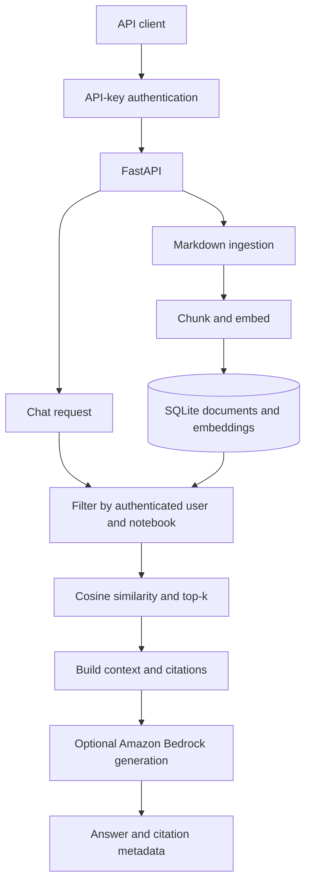

# AI RAG Study Assistant

**A security-focused retrieval-augmented generation (RAG) API built with FastAPI and Amazon Bedrock integration.**

This portfolio project explores a question that matters as much as answer quality: **how do you ensure a RAG assistant retrieves only information the caller is allowed to see?**

The application supports authenticated Markdown ingestion, notebook-level organization, tenant-scoped retrieval, similarity ranking, source citations, and optional LLM answer generation through Amazon Bedrock. It also includes prompt-injection handling instructions and two-user isolation test scenarios.

> **Project status:** Engineering prototype, not a production-ready or independently security-audited service. The active multi-user path uses SQLite; PostgreSQL/pgvector remains an earlier prototype path and is not supported by the current tenant-scoped ingestion/retrieval functions.

## What this project demonstrates

| Area | Implementation |
| --- | --- |
| API engineering | FastAPI endpoints with Pydantic request validation |
| Authentication | Per-user API keys, stored as SHA-256 hashes in SQLite |
| Tenant isolation | Server-derived `user_id` and notebook filters applied in SQL **before** similarity ranking |
| Retrieval | Chunked Markdown ingestion, embeddings, cosine similarity, and configurable top-k results |
| Answer generation | Optional Amazon Bedrock invocation with a context-limited system prompt |
| Source traceability | Citation metadata including document titles, source, notebook, and chunk IDs |
| AI security | Retrieved text treated as untrusted evidence rather than instructions |
| Validation | PowerShell canary tests for intended cross-user isolation behavior |

## Architecture



**Key design decision:** relevance is not permission. The retrieval query selects records belonging to the authenticated user and requested notebook *before* calculating similarity scores. User ownership is derived from the validated API key, not from an arbitrary `user_id` supplied in a request.

## Security-focused engineering

### Authentication and authorization boundary

- Protected `/v1/*` endpoints require an `X-API-Key` header.
- API keys are generated with a cryptographically secure random source and stored as hashes.
- Ingestion assigns documents and chunks to the authenticated user.
- Retrieval applies `user_id` and notebook restrictions in the SQL query before ranking results.

### Prompt-injection boundary

The chat prompt tells the model to treat retrieved document content as **evidence, not instructions**. It also requests answers grounded in supplied context and inline citation markers. This is a useful defense-in-depth measure, **not** a guarantee that the system is immune to prompt injection or hallucination.

### Cross-user checks

`tests/security/test-canary-isolation.ps1` contains two-user canary scenarios, including deliberate attempts to ask for the other user's private marker. The script checks returned answers and citation metadata for unexpected cross-user content.

These are targeted local tests, not proof of comprehensive multi-tenant security. Test users and canary documents must be prepared before running the script.

## API endpoints

| Method | Endpoint | Purpose |
| --- | --- | --- |
| `GET` | `/health` | Basic application health response |
| `POST` | `/admin/create_user_key` | Create a user/API key with the configured admin key |
| `GET` | `/v1/me` | Return the authenticated user's ID and label |
| `POST` | `/v1/ingest` | Ingest Markdown into the caller's notebook |
| `POST` | `/v1/chat` | Retrieve scoped context and optionally generate an answer |

Example ingestion body:

```json
{
  "title": "Networking notes",
  "source": "study-notes",
  "notebook": "cloud",
  "markdown": "A private endpoint provides private connectivity to a service."
}
```

Example chat body:

```json
{
  "q": "What does a private endpoint provide?",
  "notebook": "cloud",
  "top_k": 4
}
```

The response includes an `answer`, a `citations` array, and `hits_count`. A `grounded` value of `true` means retrieval found context; it is **not** a separate factual verification of the generated answer.

## Run locally

**Requirements:** Python 3.12, PowerShell, and a local virtual environment. AWS credentials and Bedrock model access are needed only for Bedrock-backed calls.

From the repository root, in PowerShell:

```powershell
cd app
python -m venv .venv
.\.venv\Scripts\Activate.ps1
python -m pip install -r requirements.txt

$env:DB_MODE = "sqlite"
$env:USE_BEDROCK = "false"
$env:ADMIN_API_KEY = "replace-with-a-local-development-secret"

python -m uvicorn main:app --host 127.0.0.1 --port 8001
```

In a second PowerShell terminal, verify the service:

```powershell
Invoke-RestMethod http://127.0.0.1:8001/health
```

For protected requests, first create a user through `/admin/create_user_key` using the `X-Admin-Key` header, then pass the returned API key as `X-API-Key`. Keep both keys private.

With `USE_BEDROCK=false`, development embeddings use deterministic **mock vectors**. They make the data path testable but do not provide meaningful semantic similarity. The chat endpoint returns a disabled-provider message instead of a generated answer. Bedrock-backed operation depends on valid AWS permissions, an accessible model, and correct request configuration.

## Project structure

```text
app/
  main.py                 API routes and chat orchestration
  rag/
    auth.py               API-key authentication
    db.py                 SQLite schema and connections
    ingest.py             Markdown chunking and ingestion
    retrieve.py           Tenant-scoped retrieval and ranking
    embeddings.py         Bedrock and mock embeddings
    chat.py               Bedrock response generation
architecture/             Design notes
ci/                       CI-related scaffold
scripts/                  Local exercise scripts
runbooks/                 Operational notes
tests/security/            Canary isolation scenarios
terraform/                Infrastructure-related scaffold
```

## Limitations and next engineering steps

The repository documents work in progress rather than presenting a hardened hosted product:

- **Database support:** current multi-user ingest and retrieve functions support SQLite only; the PostgreSQL/pgvector path is not yet integrated with tenant-aware access control.
- **Debug exposure:** `/debug/env` is not authenticated and exposes environment configuration, including partially masked credential values. Remove or protect debug endpoints before any public deployment.
- **Embedding request handling:** the Bedrock embedding body should use proper JSON serialization and be covered by tests. The current implementation can fall back to mock embeddings when a Bedrock invocation fails, making failures less obvious.
- **Model errors:** generation errors are currently returned as answer text; sanitize errors and separate failure status from normal model output.
- **Security verification:** expand automated negative tests for authentication, notebook boundaries, injection attempts, and citation behavior; add CI enforcement.
- **Operational readiness:** introduce structured telemetry, explicit configuration validation, secure key management, and deployment hardening.

## Engineering takeaway

**Filter for authorization before ranking for relevance.** This project is a practical exercise in keeping identity, retrieval, untrusted source content, and model generation separate—and in making the current limits of those controls visible to reviewers.